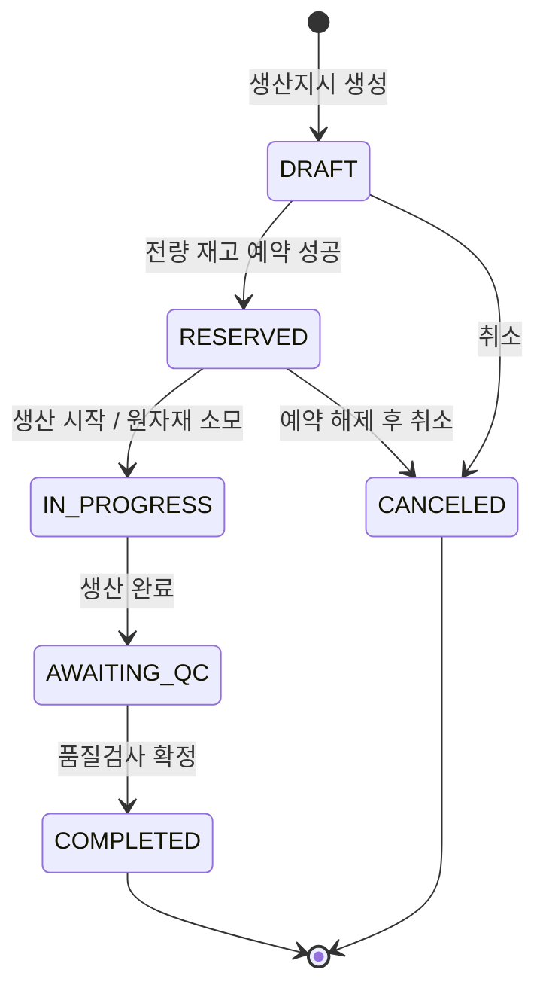
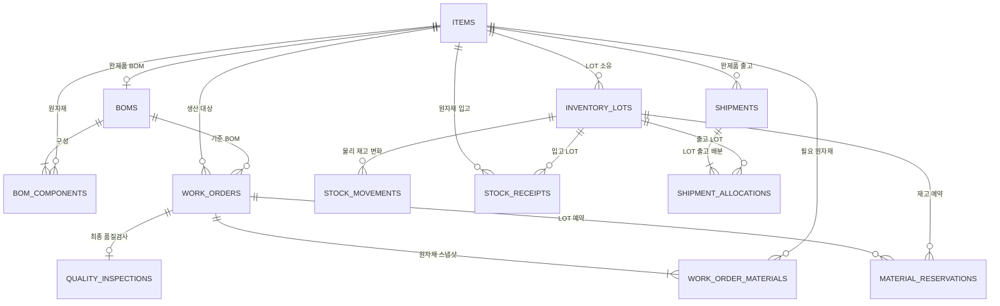

# FactoryFlow — 제품·도메인·기술 설계 SSOT v0.1

> 상태: **구현 전 설계 기준본 (Draft / TASK-001)**  
> 기준일: 2026-11-11  
> 목적: Java/Spring 백엔드 취업 포트폴리오에서 **업무 도메인 모델링, 트랜잭션, 동시성, SQL 성능, 자동화 테스트**를 입증한다.  
> 이 문서는 구현 완료 보고서가 아니다. 아래 API·스키마·테스트는 **제안·확정 예정 사양**이며 실제 구현·빌드·실행은 아직 진행하지 않았다.

---

## 0. 의사결정 상태 및 우선순위

- **확정(1차 범위):** 단일 공장·단일 창고·EA 수량, 원자재 입고 → BOM → 생산지시 → 원자재 예약 → 생산 시작 시 소모 → 생산 완료 → 품질검사 → 합격품 입고 → 완제품 출고.
- **확정(1차 구조):** Java 21, Spring Boot, JPA, MySQL 8.4, Vue 3, Docker Compose, JUnit 5, Testcontainers, GitHub Actions. 도메인별 패키지를 갖는 모듈형 모놀리식.
- **설계 제안(구현 직전 검증):** 품목 잠금 기반 직렬화, FIFO LOT 할당, 상태별 재시도 응답, 요청 키 중복 방지 구현 세부.
- **명시적 제외(1차):** 다중 공장·창고, 원가·회계, 공정 라우팅·설비·IoT, 실시간 장비 제어, 분할 생산·재작업, 구매발주, 소모품 단위 변환, 유통기한·FEFO, 사용자별 권한, 외부 ERP 연동, Kafka·MSA·Kubernetes·Redis·RAG.
- **안전한 시연 범위:** 인증·인가 구현 전에는 **로컬/격리된 데모 환경에만** 배포한다. 인터넷 공개 시 인증·접근제어와 기본 보안 정책이 먼저 필요하다.

> 이 문서와 구현이 다르면, 차이를 기록한 ADR과 테스트를 통해 사양을 변경한다. 동작하는 코드가 무조건 문서보다 우선하지는 않는다.

## 1. 해결할 문제와 목표

### 1-1. 사용자 및 가치

- **생산 담당자:** 생산지시를 등록하고 원자재 부족 여부를 확인하며 작업 상태를 관리한다.
- **창고 담당자:** 원자재 LOT 입고와 완제품 출고, 현재고·가용재고·재고 변동 이력을 관리한다.
- **품질 담당자:** 생산 결과의 합격·불합격 수량을 기록한다.
- 한 명의 데모 운영자가 세 역할을 수행하는 것을 1차 MVP의 전제로 한다. 이 전제는 실제 기업 권한 모델을 대체하지 않는다.

### 1-2. 포트폴리오 검증 목표

1. 하나의 주문을 처리하는 정상 흐름이 끝까지 연결된다.
2. 물리 재고(`onHand`)와 예약 재고(`reserved`)가 구분되고, `available = onHand - reserved`가 항상 성립한다.
3. 동일 품목을 동시에 예약·출고해도 수량이 음수가 되거나 초과 할당되지 않는다.
4. 실패 시 관련 데이터가 **한 DB 트랜잭션으로 전부 롤백**된다.
5. 중복 입고·출고 요청이 재고를 재반영하지 않는다.
6. 인덱스·잠금 정책 변경 전후의 **재현 가능한 수치**를 남긴다. 목표 처리량·지연 시간은 측정 전 임의로 선언하지 않는다.

### 1-3. 성공 기준 예시 시나리오

브래킷(`FG-BRACKET`) 1개에 철판(`RM-SHEET`) 1개와 볼트(`RM-BOLT`) 2개가 필요하다.

| 시점 | 철판 현재고 | 철판 예약 | 철판 가용 | 볼트 현재고 | 볼트 예약 | 볼트 가용 | 브래킷 가용 |
|---|---:|---:|---:|---:|---:|---:|---:|
| 입고 직후 | 100 | 0 | 100 | 200 | 0 | 200 | 0 |
| 50개 생산 예약 | 100 | 50 | 50 | 200 | 100 | 100 | 0 |
| 생산 시작(소모 확정) | 50 | 0 | 50 | 100 | 0 | 100 | 0 |
| 생산 종료 후 검사 전 | 50 | 0 | 50 | 100 | 0 | 100 | 0 |
| 합격 47개 / 불합격 3개 | 50 | 0 | 50 | 100 | 0 | 100 | 47 |
| 합격품 10개 출고 | 50 | 0 | 50 | 100 | 0 | 100 | 37 |

불합격 3개는 검사 이력에 남지만 **가용 완제품 재고로 들어가지 않는다**. 이 MVP에서는 추가 자재 소모, 재작업, 부분 생산을 지원하지 않는다.

---

## 2. 핵심 불변조건 (Invariants)

| ID | 항상 참이어야 하는 규칙 | 적용 계층 |
|---|---|---|
| INV-01 | LOT별 `on_hand_qty >= 0` | 서비스 + DB CHECK |
| INV-02 | LOT별 `0 <= reserved_qty <= on_hand_qty` | 서비스 + DB CHECK |
| INV-03 | 가용 수량은 `on_hand_qty - reserved_qty`로 계산한다 | 도메인 로직 |
| INV-04 | 원자재 예약은 전체 BOM 필요량을 모두 확보하거나 전부 실패한다 | DB 트랜잭션 |
| INV-05 | 생산 시작 시 해당 지시의 예약 수량만 `on_hand`, `reserved`에서 함께 차감한다 | DB 트랜잭션 |
| INV-06 | 생산지시의 상태 전이는 정의된 경로만 허용한다 | 서비스 + 상태 테스트 |
| INV-07 | 하나의 생산지시에 품질검사 결과는 한 번만 확정한다 | DB UNIQUE + 상태 검증 |
| INV-08 | `passed_qty + failed_qty = planned_qty`, 각 수량은 0 이상 | 서비스 + DB CHECK(가능한 범위) |
| INV-09 | 합격 수량만 완제품 LOT에 입고한다 | 서비스 + 트랜잭션 |
| INV-10 | 재고 증감과 재고 이동 로그는 동일한 트랜잭션에서 기록한다 | 서비스 + DB |
| INV-11 | 동일 `requestKey` 재전송은 같은 결과를 반환하거나 충돌 처리하며 수량을 재반영하지 않는다 | DB UNIQUE + 요청 비교 |
| INV-12 | 품목·LOT·입출고·검사 이력을 물리 삭제하지 않는다 | API/운영 정책 |
| INV-13 | 원자재만 BOM 구성품/일반 입고 대상으로, 완제품만 품질 합격 입고/출고 대상으로 허용한다 | 도메인 검증 |

> **중요:** `CHECK`와 `UNIQUE`는 서비스 검증의 대체물이 아니다. 서비스는 의미 있는 오류를 반환하고, DB 제약조건은 경쟁 상황에서 최종 안전망이 된다.

---

## 3. 도메인 용어 및 상태

| 용어 | 의미 |
|---|---|
| 품목(Item) | 원자재(`RAW_MATERIAL`) 또는 완제품(`FINISHED_GOOD`) |
| BOM | 완제품 1개를 만드는 데 필요한 원자재 목록과 정수 수량 |
| LOT | 추적 가능한 품목별 재고 단위. 같은 품목에 여러 LOT가 존재 가능 |
| 현재고(onHand) | 해당 LOT에 물리적으로 남아 있는 수량 |
| 예약고(reserved) | 생산지시 때문에 다른 작업에 할당할 수 없는 수량 |
| 가용재고(available) | 현재고 − 예약고 |
| 생산지시(Work Order) | 완제품 품목·생산 수량·BOM 스냅샷·진행 상태 |
| 예약(Reservation) | 어떤 생산지시가 어떤 LOT에서 몇 개를 확보했는지 기록 |
| 재고 이동(Movement) | 실제 물리 재고 증감의 불변 이력 |
| 품질검사(Inspection) | 생산 완료 수량에 대한 합격/불합격 확정 기록 |

### 3-1. 생산지시 상태 전이



| 현재 상태 | 요청 | 다음 상태 | 업무 동작 |
|---|---|---|---|
| DRAFT | reserve | RESERVED | BOM 전체 필요량을 LOT별 예약 |
| DRAFT | cancel | CANCELED | 재고 변경 없음 |
| RESERVED | start | IN_PROGRESS | 예약 원자재 실제 소모, 이동 이력 생성 |
| RESERVED | cancel | CANCELED | 예약 해제, 가용량 복구 |
| IN_PROGRESS | finish | AWAITING_QC | 생산 수량 완료로 간주 (부분 생산 없음) |
| AWAITING_QC | inspect | COMPLETED | 품질검사 확정, 합격품 완제품 LOT 생성 |
| 그 외 | 위 명령 | 변경 없음 | HTTP 409 `STATE_CONFLICT` |

- **MVP 제약:** `IN_PROGRESS` 이후 취소·원자재 반환·생산 수량 변경·재작업은 불가. 후속 버전에서 별도의 반납/스크랩/조정 도메인으로 설계한다.
- `finish`는 무조건 계획 생산량이 완성되었다고 가정하는 데모 기능이다. 실제 제조현장의 부분 실적·불량 발생 시점은 별도 확장이 필요하다.
- `COMPLETED`는 **검사까지 확정된 상태**다. 합격 0개, 불합격 전량이어도 생산·검사 업무 종료라는 의미에서 `COMPLETED`가 가능하다.

### 3-2. 예약 상태

`RESERVED → CONSUMED` (생산 시작) 또는 `RESERVED → RELEASED` (생산지시 취소). 이력 레코드는 남긴다. 예약·해제는 물리 재고 이동 로그가 아니라 예약 레코드에서 추적한다.

---

## 4. 데이터 모델 / ERD

### 4-1. ERD (논리 모델)



### 4-2. 테이블 정의 (핵심 컬럼)

| 테이블 | 핵심 컬럼 | 제약 / 인덱스 |
|---|---|---|
| `items` | `id`, `sku`, `name`, `item_type`, `unit`, `active`, `created_at` | PK(`id`), UNIQUE(`sku`), `unit='EA'` 고정 |
| `boms` | `id`, `finished_item_id`, `created_at` | UNIQUE(`finished_item_id`), 품목 유형 검증 |
| `bom_components` | `id`, `bom_id`, `raw_item_id`, `qty_per_unit` | UNIQUE(`bom_id`,`raw_item_id`), `qty_per_unit > 0` |
| `inventory_lots` | `id`, `item_id`, `lot_code`, `source_type`, `cumulative_in_qty`, `on_hand_qty`, `reserved_qty`, `received_at` | UNIQUE(`item_id`,`lot_code`), CHECK 수량 불변조건, INDEX(`item_id`,`received_at`,`id`) |
| `stock_receipts` | `id`, `request_key`, `payload_hash`, `item_id`, `inventory_lot_id`, `quantity`, `created_at` | UNIQUE(`request_key`), `quantity > 0` |
| `work_orders` | `id`, `order_no`, `client_request_id`, `request_hash`, `finished_item_id`, `bom_id`, `planned_qty`, `status`, `created_at`, 상태별 시각 | UNIQUE(`order_no`), UNIQUE(`client_request_id`), INDEX(`status`,`created_at`) |
| `work_order_materials` | `id`, `work_order_id`, `material_item_id`, `required_qty` | UNIQUE(`work_order_id`,`material_item_id`), `required_qty > 0` |
| `material_reservations` | `id`, `work_order_id`, `material_item_id`, `inventory_lot_id`, `quantity`, `status`, 상태별 시각 | UNIQUE(`work_order_id`,`inventory_lot_id`), INDEX(`work_order_id`,`status`) |
| `quality_inspections` | `id`, `work_order_id`, `passed_qty`, `failed_qty`, `inspected_at` | UNIQUE(`work_order_id`), CHECK 각 수량 `>=0` |
| `shipments` | `id`, `request_key`, `payload_hash`, `finished_item_id`, `quantity`, `created_at` | UNIQUE(`request_key`), `quantity > 0` |
| `shipment_allocations` | `id`, `shipment_id`, `inventory_lot_id`, `quantity` | UNIQUE(`shipment_id`,`inventory_lot_id`) |
| `stock_movements` | `id`, `inventory_lot_id`, `item_id`, `movement_type`, `quantity`, `reference_type`, `reference_id`, `created_at` | INDEX(`item_id`,`created_at`), UNIQUE(`movement_type`,`reference_type`,`reference_id`,`inventory_lot_id`), `quantity>0` |

#### 설계상 주의

- DB 제약만으로 서로 다른 테이블의 타입 관계(예: BOM 구성품은 RAW)를 보장할 수 없다. **서비스 검증+통합 테스트**로 강제한다.
- `stock_movements.reference_type/reference_id`는 여러 업무 원천을 가리키는 다형 참조로 직접 FK가 걸리지 않는다. 서비스 트랜잭션과 참조 무결성 검증 테스트로 보완한다. 필요 시 후속 버전에서 참조 테이블 분리.
- `inventory_lots.cumulative_in_qty`는 동일 LOT에 여러 번 입고하면 누적된다. `on_hand_qty`는 출고·소모를 반영한 실제 잔량이다.
- `work_order_materials`는 **생산지시 생성 시 BOM의 불변 스냅샷**을 복사한다. 구성 수량은 `qty_per_unit × planned_qty`로 `Math.multiplyExact` 또는 사전 최대치 검증을 통해 오버플로를 방지한다.
- 1차에는 완제품 하나당 BOM 하나만 정의하며, 등록 후 BOM 수정 API를 제공하지 않는다. 이력 있는 BOM 버전 변경은 후속 과제다.
- LOT 코드는 품목 내 유일하다. 원자재는 외부 입력 LOT, 합격 완제품은 시스템 생성 코드(예: `FG-WO-<id>`)를 사용한다. 코드 충돌·길이·문자 집합을 검증한다.
- DB 마이그레이션은 **Flyway**로 버전 관리하고 수동 스키마 변경을 금지한다.
- 시간은 DB에서 UTC 기준으로 저장하며, Vue에서 한국 시간으로 표시한다.

### 4-3. 재고 이동 종류

| 이동 종류 | 현재고 변화 | 발생 조건 | 원천 참조 |
|---|---:|---|---|
| `RAW_RECEIPT` | `+quantity` | 원자재 입고 | `stock_receipts.id` |
| `RAW_CONSUMPTION` | `-quantity` | 생산 시작 / 예약 소모 | `work_orders.id` |
| `FINISHED_RECEIPT` | `+passedQty` | 품질검사 확정 | `quality_inspections.id` |
| `FINISHED_SHIPMENT` | `-quantity` | 완제품 출고 | `shipments.id` |

> 재고 예약과 해제는 물리 재고 변동이 아니므로 위 이동 종류에 포함하지 않는다. 재고 잔량과 이동 이력은 항상 같은 트랜잭션에서 기록한다.

---

## 5. 핵심 트랜잭션 / 동시성 설계

### 5-1. 공통 원칙

- 모든 재고 **쓰기 명령**은 단일 MySQL 트랜잭션에서 처리한다.
- 트랜잭션 격리는 1차에서 `READ_COMMITTED`를 검토·적용하고, MySQL/InnoDB 실제 동작을 Testcontainers로 검증한다. 기본 `REPEATABLE_READ`와의 차이는 ADR에 기록한다.
- **애플리케이션 메모리 락이나 Redis 락 없이** MySQL의 `SELECT ... FOR UPDATE` 성격의 비관적 잠금을 1차 기준으로 사용한다.
- 동시에 여러 품목을 건드릴 때 잠금 순서를 통일한다: **관련 Item ID 오름차순 → WorkOrder 행(있는 경우) → InventoryLot 행(품목 ID, 입고시각, LOT ID 순)**. 다른 명령도 동일 순서를 지켜 교착상태 위험을 줄인다.
- 읽기용 조회와 수정용 조회를 분리하고, 비관적 잠금은 실제 **명령 트랜잭션 내부**에서만 건다.
- MySQL 데드락/락 타임아웃 가능성은 0이 아니므로, 적절한 오류 반환 및 테스트를 갖춘다. 임의 무한 재시도는 금지한다.

**단순화를 위한 선택:** 재고를 움직이는 모든 명령이 품목 행을 먼저 잠그기 때문에 같은 품목에 대한 예약·입고·출고가 사실상 직렬화된다. 처리량에는 불리할 수 있지만 초기 MVP의 정합성을 설명·검증하기 쉽다. 측정 후 LOT 단위 최적화를 검토한다.

### 5-2. 원자재 입고 (`POST /stock-receipts`)

1. `requestKey`와 정규화된 요청 내용의 해시를 확인한다. 같은 키·같은 내용이면 기존 결과를 반환, 같은 키·다른 내용이면 409.
2. 원자재 품목을 `FOR UPDATE`로 잠근다.
3. 품목+LOT 코드로 기존 LOT가 있으면 잠근 뒤 수량을 더하고, 없으면 새 LOT를 만든다.
4. 입고 레코드와 `RAW_RECEIPT` 재고 이동을 저장한다.
5. **수량 변경·입고·이동 이력 모두 성공해야 commit**한다.
6. 병렬 중복 요청은 `request_key` UNIQUE가 최종 방어한다. 충돌 발생 트랜잭션을 롤백한 뒤 **새 트랜잭션에서** 기존 요청을 읽어 비교한다.

### 5-3. 생산지시 생성

1. 활성 완제품과 BOM을 조회한다.
2. BOM 구성품별 필요 수량과 품목 ID를 `work_order_materials`에 복사한다.
3. `work_orders.status=DRAFT`로 저장한다. 이 단계에서 재고는 건드리지 않는다.
4. `clientRequestId` UNIQUE + 요청 해시로 중복 생성 방지. BOM이 변경 가능한 미래 버전에서도 스냅샷은 변경하지 않는다.

### 5-4. 재고 예약 (`DRAFT → RESERVED`)

1. 생산지시 스냅샷으로 원자재 품목 ID를 확인한다.
2. 대상 품목을 **ID 오름차순 잠금** → 생산지시 행 잠금, 여전히 DRAFT인지 재검증한다.
3. 원자재별 LOT를 `received_at ASC, id ASC` 순서로 조회·잠금한다(FIFO).
4. LOT 가용량을 계산해 필요한 만큼 예약한다. 한 LOT에서 부족하면 다음 LOT로 배분한다.
5. 모든 구성 원자재에 대한 충분한 수량이 확보되지 않으면 전체 트랜잭션 롤백. **부분 예약 금지.**
6. LOT별 `reserved_qty` 증가, `material_reservations` 저장, 생산지시를 RESERVED로 변경한 뒤 commit.

### 5-5. 생산 시작 (`RESERVED → IN_PROGRESS`)

1. 품목 → 생산지시 → 할당 LOT 순으로 잠금한다.
2. 현재 상태와 활성 예약 레코드를 검증한다.
3. 예약 LOT마다 `on_hand_qty -= reservedQuantity`, `reserved_qty -= reservedQuantity` 처리.
4. 예약 상태를 CONSUMED로 바꾸고 `RAW_CONSUMPTION` 이동 이력을 작성한다.
5. 생산지시를 IN_PROGRESS로 변경한다. 하나라도 실패하면 전부 롤백.

예: 현재고 10, 예약 8, 가용 2인 LOT는 생산 시작 후 **현재고 2, 예약 0, 가용 2**가 된다. 다른 작업의 예약이 있으면 그 예약량은 유지되어야 한다.

### 5-6. 생산지시 취소 (`DRAFT/RESERVED → CANCELED`)

- DRAFT: 상태만 변경.
- RESERVED: 해당 지시의 RESERVED 예약량을 각 LOT에서 차감하고 예약을 RELEASED로 변경, 상태를 CANCELED로 변경.
- IN_PROGRESS 이후에는 거부(409). 취소를 통해 이미 소모한 자재를 되살리는 처리는 MVP에 없다.

### 5-7. 생산 완료·품질검사

- `finish`: IN_PROGRESS에서 AWAITING_QC로 변경. 계획 수량 전량 생산 완료로 간주한다.
- `inspect`: 완제품 품목을 잠근 다음 생산지시 행을 잠그고 AWAITING_QC인지 재검증한다.
- `passedQty >= 0`, `failedQty >= 0`, `passedQty + failedQty == plannedQty` 조건 검사.
- 품질검사 1행 저장. 합격량이 1 이상이면 완제품 LOT 생성 + 해당 수량 입고 + `FINISHED_RECEIPT` 이동 저장.
- 불합격 수량은 검사 기록에만 남고 완제품 재고에는 반영되지 않는다.
- 품질검사 결과 및 재고 반영 후 생산지시를 COMPLETED로 변경하며 일괄 commit.

### 5-8. 완제품 출고

1. `requestKey` 중복 여부와 완제품 품목을 확인한다.
2. 품목을 잠근 뒤 가용한 완제품 LOT를 FIFO로 잠근다.
3. 필요한 전량이 없으면 롤백(부분 출고 금지).
4. `on_hand_qty`를 감소시키고 출고·LOT별 할당·재고 이동 이력을 동시에 저장한다.
5. 출고 요청 재전송은 `requestKey`로 멱등성을 보장한다.

> 생산 완료와 품질검사 사이에는 완제품 LOT가 만들어지지 않는다. 검사 불합격 제품이 출고되는 경로를 구조적으로 줄이기 위한 설계다.

---

## 6. REST API 초안

Prefix: `/api/v1` · JSON/UTF-8 · 성공 시 `data`를 포함한 응답 · 입력 오류는 일관된 `errorCode`, `message`, `traceId` 응답.

| Method | Path | 목적 | 입력 핵심 | 성공 | 주요 실패 |
|---|---|---|---|---|---|
| POST | `/items` | 품목 등록 | `sku,name,itemType` | 201 | 400, 409 SKU 중복 |
| GET | `/items` | 품목 조회 | `itemType,keyword,page,size` | 200 | 400 |
| POST | `/boms` | 완제품 BOM 등록 | `finishedItemId,components[]` | 201 | 400/404/409 |
| GET | `/boms/{finishedItemId}` | BOM 확인 | Path ID | 200 | 404 |
| POST | `/stock-receipts` | 원자재 LOT 입고 | `requestKey,itemId,lotCode,quantity` | 201/200 재조회 | 400/404/409 |
| GET | `/inventory` | 품목 재고 요약 | `itemId,itemType` | 200 | 400 |
| GET | `/inventory/{itemId}/lots` | 품목 LOT별 재고 | Path ID | 200 | 404 |
| GET | `/stock-movements` | 재고 이동 조회 | `itemId,from,to,page,size` | 200 | 400 |
| POST | `/work-orders` | 생산지시 생성 | `clientRequestId,finishedItemId,plannedQty` | 201/200 재조회 | 400/404/409 |
| GET | `/work-orders` | 생산지시 검색 | `status,page,size` | 200 | 400 |
| GET | `/work-orders/{id}` | 생산지시 상세 | Path ID | 200 | 404 |
| POST | `/work-orders/{id}/reserve` | 원자재 전량 예약 | Path ID | 200 | 404/409 |
| POST | `/work-orders/{id}/start` | 원자재 소모 및 생산 시작 | Path ID | 200 | 404/409 |
| POST | `/work-orders/{id}/finish` | 생산 완료 | Path ID | 200 | 404/409 |
| POST | `/work-orders/{id}/cancel` | 생산지시 취소 | Path ID | 200 | 404/409 |
| POST | `/work-orders/{id}/inspection` | 품질검사 확정 | `passedQty,failedQty` | 201 | 400/404/409 |
| POST | `/shipments` | 완제품 출고 | `requestKey,finishedItemId,quantity` | 201/200 재조회 | 400/404/409 |

**요청 예시**

```json
POST /api/v1/stock-receipts
{
  "requestKey": "RCV-20261111-0001",
  "itemId": 1,
  "lotCode": "STEEL-LOT-001",
  "quantity": 100
}
```

```json
POST /api/v1/boms
{
  "finishedItemId": 3,
  "components": [
    {"rawItemId": 1, "quantityPerUnit": 1},
    {"rawItemId": 2, "quantityPerUnit": 2}
  ]
}
```

```json
POST /api/v1/work-orders
{
  "clientRequestId": "WO-CLIENT-0001",
  "finishedItemId": 3,
  "plannedQty": 50
}
```

```json
POST /api/v1/work-orders/1/inspection
{"passedQty": 47, "failedQty": 3}
```

**응답 정책**

- 신규 생성: 201 Created + 리소스 정보/위치. 멱등성 키 동일·내용 동일한 재시도: 기존 리소스 200 OK.
- 존재하지 않는 리소스: 404 `RESOURCE_NOT_FOUND`.
- 형식·수량 오류: 400 `INVALID_REQUEST`.
- 재고 부족: 409 `INSUFFICIENT_STOCK`.
- 상태 전이 불가능: 409 `STATE_CONFLICT`.
- 동일 멱등성 키에 다른 요청 내용: 409 `IDEMPOTENCY_KEY_CONFLICT`.
- SKU/BOM 고유키 충돌: 409 `DUPLICATE_RESOURCE`.
- DB 제약·잠금 충돌: 적절한 오류로 매핑하되 오류 세부 정보(내부 SQL, 스택트레이스)는 사용자에게 노출하지 않는다.
- 리퀘스트 키가 없는 상태 변경 명령(`reserve`, `start`, `finish`, `cancel`, `inspection`)의 **재호출은 중복 실행하지 않고 409**로 응답한다. 이미 반영되었는지 확인하려면 GET 조회를 사용한다. 투명한 재시도용 명령 키는 후속 확장이다.

---

## 7. 파일 / 패키지 책임

```text
factoryflow/
├─ backend/
│  ├─ src/main/java/com/factoryflow/
│  │  ├─ item/                  # 품목 마스터, BOM
│  │  ├─ inventory/             # LOT, 입고, 이동, 재고 집계
│  │  ├─ production/            # 생산지시, 스냅샷, 예약 및 상태 전이
│  │  ├─ quality/               # 품질검사, 합격품 반영
│  │  ├─ shipment/              # 완제품 출고
│  │  └─ global/                # 예외 응답, 설정, 공통 시간 처리
│  ├─ src/main/resources/db/migration/
│  └─ src/test/java/com/factoryflow/
├─ frontend/                   # Vue 3, Pinia, API 호출 / 조회 UI
├─ infra/                      # docker-compose.yml / 환경 예제
├─ docs/                       # SSOT, ADR, ERD, 검증 보고서
├─ tasks/                      # 작업 단위별 지시서
└─ README.md
```

- Controller: HTTP 입력/응답 및 검증 시작점. 재고 수량 변경 로직 금지.
- Service: 상태 전이, 트랜잭션 경계, 도메인 불변조건 검증.
- Repository: JPA 조회·잠금. DTO와 엔티티 직접 노출을 분리.
- DB: UNIQUE/CHECK/FK 및 인덱스로 최종 데이터 무결성 보장.
- Vue: 입력 검증 보조·업무 상태 표시, **재고 계산의 최종 판단은 서버**.

---

## 8. 테스트 매트릭스와 재현 절차

### 8-1. 우선 테스트 케이스

| ID | 유형 | 시나리오 | 기대 결과 |
|---|---|---|---|
| T-01 | 정상 | 철판100/볼트200 입고 → BOM(1/2) → 50개 생산 예약 | 철판 예약50, 볼트 예약100, 실제 현재고 미변경 |
| T-02 | 정상 | 생산 시작 | 철판·볼트 현재고가 각각 50·100 감소, 예약 0, 이동 로그 2건 |
| T-03 | 정상 | 생산 완료 → QC 합격47/불합격3 | 완제품 47개, 불합격품 가용재고 미포함 |
| T-04 | 정상 | 완제품 10개 출고 | 완제품 현재고 37, 출고 이력·LOT 할당 존재 |
| T-05 | 경계 | 같은 원자재 재고 10개, 8개 필요한 서로 다른 생산지시 2건 동시 예약 | 성공 1건, 실패 1건; 음수·초과 예약 없음 |
| T-06 | 동시성 | 가용 30개, 1개 필요한 생산지시 100건 동시 예약 | 성공 정확히 30건(환경 오류 없이 정상 처리 시), 잔량 0, DB 불변조건 유지 |
| T-07 | 트랜잭션 | BOM 첫 품목은 충분, 두 번째 품목 부족 | 예약 상태·LOT 예약 수량 모두 원상 유지 |
| T-08 | 트랜잭션 | 생산 시작 중 이동 로그 기록 실패 주입 | 재고 차감·예약 소비·상태 변경 모두 롤백 |
| T-09 | 취소 | RESERVED 생산지시 취소 | 재고 가용량 복구, 예약 RELEASED |
| T-10 | 상태 | IN_PROGRESS 취소, COMPLETED 재검사, DRAFT start | 409, 데이터 변경 없음 |
| T-11 | 멱등성 | 같은 입고 `requestKey` 동일 요청 2회 | 재고 한 번만 증가, 동일 결과 반환 |
| T-12 | 멱등성 | 같은 `requestKey`, 다른 quantity | 409, 재고 변경 없음 |
| T-13 | 멱등성/동시성 | 동일 `requestKey`를 병렬 전송 | 입고 하나만 확정 |
| T-14 | 상태/제약 | 검사 pass+fail이 계획 수량과 다름 | 400, 완제품 LOT·검사 행 미생성 |
| T-15 | 경계 | QC 합격 0/불합격 전량 | 검사 확정, 완제품 LOT 생성 없음, 재고 0 |
| T-16 | 출고 | 가용 완제품 5개에 출고 4개 요청 2건 경쟁 | 한 건만 성공, 출고 합계 4개 |
| T-17 | 스냅샷 | 생산지시 생성 후 BOM 수정 요청 | MVP에서 수정 API 부재; 지시 스냅샷 불변 |
| T-18 | 정합성 | 재고 이동 합계를 초기값과 대조 | 물리 현재고와 이력 일치 |
| T-19 | DB | MySQL CHECK·UNIQUE·FK 위반 유도 | 제약이 실제 DB에서 강제됨 |
| T-20 | 성능 | 인덱스 전후 LOT·이동 이력 조회 비교 | EXPLAIN 및 동일 데이터 조건의 p50/p95 측정 기록 |

### 8-2. 테스트 구현 기준

- 단위: JUnit 5 + Mockito(서비스의 순수 규칙 검사 위주).
- 통합: `@SpringBootTest` + **Testcontainers MySQL 8.4** + Flyway 마이그레이션.
- 동시성: `ExecutorService`와 `CountDownLatch`로 시작 시점 맞추고, **각 요청이 별도 DB 트랜잭션**을 사용하도록 한다.
- 동시성 테스트를 수행하는 테스트 메서드 전체에 `@Transactional`을 붙여 같은 테스트 트랜잭션으로 결과를 오염시키지 않는다.
- 장애 주입: 테스트 전용 Repository 실패 구현 또는 Mock Bean을 사용해 서비스 트랜잭션 경계에서 강제 실패.
- 검증: HTTP 결과뿐 아니라 LOT, 예약, 이동 로그, 검사, 출고의 DB 상태를 조회해 비교한다.
- 성능: MySQL 샘플 데이터 크기, 인덱스, 실행 환경, 요청 수, 동시성, 지연시간 분포를 함께 기록한다. 결과값을 예상 수치로 채우지 않는다.
- 테스트 실행 조건: 로컬 Docker Engine 작동 및 CI에서 Testcontainers 실행 가능 여부를 먼저 확인.

---

## 9. 프론트엔드 MVP 화면

1. **현황:** 품목·LOT 수, 생산 상태별 건수, 재고 부족 경고(서버 계산 기반).
2. **품목/BOM:** 원자재·완제품 등록, 제품 BOM 조회·등록.
3. **입고/재고:** LOT 입고, 현재고/예약/가용재고, 이동 이력.
4. **생산지시:** 생성, 예약, 시작, 완료, 취소(상태별 버튼 제한).
5. **품질·출고:** 검사 수량 입력, 합격품 LOT 조회, 완제품 출고.

> 1차 UI는 시연에 필요한 최소한의 데스크톱 관리자 화면으로 제한한다. 예쁜 대시보드보다 업무 흐름과 데이터 검증이 우선이다.

---

## 10. ADR 초안 (기술 선택 이유)

| ID | 결정 | 선택한 이유 | 비용·한계 |
|---|---|---|---|
| ADR-001 | 모듈형 모놀리식 | 하나의 DB 트랜잭션에서 재고 정합성을 검증하기 쉽고 배포 단순 | 독립 서비스 스케일링 없음 |
| ADR-002 | JPA + MySQL | MyBatis와 다른 ORM 활용 능력, 영속성·락 학습 | N+1, flush, 잠금 쿼리·영속성 컨텍스트 주의 |
| ADR-003 | LOT FIFO 예약 | LOT 추적 가능, 구현 복잡도 제한 | 유통기한 FEFO·보관 위치 고려 안 함 |
| ADR-004 | 예약과 차감 분리 | 업무 의미를 명확히 하고 초과 사용 방지 | 예약 해제·소모 트랜잭션 추가 |
| ADR-005 | Item 선잠금 + LOT 잠금 | 동시성 안전성을 단순하게 입증 가능 | 동종 품목 경합 시 처리량 저하 |
| ADR-006 | QC 이후 합격품 입고 | 불량품 출고 방지 | 실제 공장의 검사대기/격리 재고 모델 축약 |
| ADR-007 | 요청 멱등성 키 + DB UNIQUE | 네트워크 재전송 시 중복 입고·출고 방지 | 충돌 후 새 트랜잭션으로 기존 데이터 조회 필요 |
| ADR-008 | Testcontainers MySQL | H2와 다른 MySQL 실제 잠금·제약을 검증 | 테스트 실행 시간·Docker 의존성 |

### 추후 비교 실험 후보 (MVP 이후)

- 비관적 락 vs 낙관적 락(`@Version`) vs 조건부 UPDATE: 충돌률·실패 응답·처리량 측정.
- 품목 행 선잠금 vs LOT 최소 잠금: 교착상태·경합·성능 비교.
- DB 원본 데이터 분석 vs AI 기반 집계 설명 및 RAG: 별도 기능으로 확장.
- Redis 캐시는 실제 읽기 병목이 입증된 뒤에만 도입.

---

## 11. 시니어 관점 검토 / 개선 분류

### 잘한 점 (설계에서 유지)

- 실무 업무 흐름이 기능 CRUD 이상의 트랜잭션·정합성 문제로 연결된다.
- 원재료 예약과 실제 소모를 분리해 상태 의미가 명확하다.
- 트랜잭션과 멱등성에 DB 제약조건을 함께 활용한다.
- Testcontainers로 MySQL 동시성 동작을 실제 검증하도록 설계했다.

### 위험한 점 (구현 시 중점 리뷰)

1. **교착상태:** 서로 다른 명령의 잠금 순서가 다르면 발생 가능. 동일한 순서·명시적 통합 테스트 필수.
2. **JPA 영속성 컨텍스트:** 벌크 UPDATE, lock query, dirty checking, flush 순서가 예상과 다를 수 있다. 트랜잭션 단위 검증 필요.
3. **동시 멱등성:** UNIQUE 충돌 후 같은 실패 트랜잭션에서 조회하면 정상 결과를 얻지 못할 수 있다. 새 트랜잭션에서 재조회.
4. **LOT별 합계 검증:** `reserved <= onHand`는 같은 시점의 행 값으로 검사해야 한다. 단순 사전 `SELECT SUM`만으로 동시성 방어 불가.
5. **MVP 단순화:** 부분 생산·재작업·폐기·반품 부재. 실제 MES 전체 기능 구현처럼 과장하지 않는다.
6. **공개 배포:** 인증·인가 없이 생산·재고를 수정할 수 있는 API를 인터넷에 공개하면 안 된다.

### 지금 당장 고칠 것 (TASK-002 이후 구현 체크)

- 정수 수량과 오버플로 방어, 요청 DTO Bean Validation.
- Flyway 스키마, DB 제약조건, 테스트 데이터 생성 전략.
- API 에러 코드·트랜잭션·잠금 순서 단일 규칙 구현.
- DB 동시성 테스트와 중복 요청 재현.

### 나중에 미뤄도 되는 것

- Redis, Kafka, Kubernetes, AI Agent/RAG, 사용자 역할, 구매·납기·실시간 설비, 물류 다중 창고, 원가 정산.

### 포트폴리오 발표 표현

> "제조업의 원자재 입고부터 완제품 출고까지의 도메인을 설계하고, LOT별 가용재고와 생산 예약을 구분했습니다. DB 트랜잭션과 비관적 잠금으로 동시 생산지시의 초과 예약을 방지했으며, Testcontainers 기반 동시성 테스트로 데이터 정합성을 검증했습니다."

위 문장은 **구현·테스트가 완료된 이후에만** 과거형으로 사용한다. 현재는 *설계했습니다/검증할 계획입니다* 수준이다.

---

## 12. 구현 Task 로드맵 / 종료 기준

| Task | 범위 | 완료 조건 |
|---|---|---|
| TASK-001 | SSOT·ERD·API·상태·트랜잭션·테스트 설계 | 이 문서 초안 완료, 위험·제약조건 기록 |
| TASK-002 | 프로젝트 골격, MySQL/Flyway, JPA, 예외 응답, Testcontainers | clean build + DB 마이그레이션 + 테스트 실행 성공 |
| TASK-003 | 품목·BOM·원자재 입고·LOT 재고 | API 정상/오류/입고 중복 테스트 통과 |
| TASK-004 | 생산지시·BOM 스냅샷·재고 예약·취소 | T-05~T-07/T-09 동시성·롤백 검증 |
| TASK-005 | 생산 시작·자재 소모·품질검사·합격품 입고 | T-02/T-03/T-08/T-14/T-15 통과 |
| TASK-006 | 완제품 출고·재고 이력·정합성 | T-04/T-16/T-18 통과 |
| TASK-007 | Vue UI와 Docker 실행·CI | 단일 시나리오 UI 시연 및 CI 통과 |
| TASK-008 | SQL·동시성 성능 실험 / 검증 보고서 | 실행 조건·측정 결과·트레이드오프를 수치로 기록 |

**전역 완료 조건:** 테스트 통과 로그, 재현 명령, API 예시, ERD 최신화, 실행 스크린샷을 README에 연결하고 `TROUBLESHOOTING.md`에 실제 발생한 문제만 기록한다.

---

## 13. 아직 구현하지 않은 사항 / 진행 상태

- [x] TASK-001 요구사항 및 기술 설계 문서 v0.1 작성
- [x] 정상/경계/경쟁 상태 테스트 초안 작성
- [ ] 프로젝트 저장소 및 실제 소스 생성
- [ ] Spring Boot clean build
- [ ] MySQL Docker Compose / Flyway 적용
- [ ] API 구현 및 실행 확인
- [ ] Testcontainers 동시성 테스트 통과
- [ ] Vue UI 구현 및 브라우저 시연
- [ ] 성능 실측 / 포트폴리오 결과 정리

### 직접 설명할 핵심 요약

**FactoryFlow는 업무 상태와 재고의 의미를 분리하는 프로젝트다.** 주문은 먼저 LOT별 원자재를 예약하고, 생산 시작 시 실제 재고를 소모한다. 품질검사 후 합격품만 완제품 재고에 넣는다. 이 모든 과정의 수량 불변조건과 실패 시 원자성, 동시 요청의 정합성을 MySQL 트랜잭션 및 Testcontainers 테스트로 입증한다.
